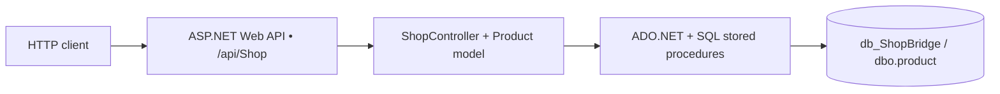

# ShopBridge

**Product catalog CRUD API built with ASP.NET Web API 2, .NET Framework 4.8 and Microsoft SQL Server.**

ShopBridge is a small learning/demo project for creating, listing, updating and deleting products through HTTP endpoints. It uses C# controllers, ADO.NET (`SqlConnection`, `SqlCommand`, `SqlDataAdapter`) and SQL Server stored procedures. It also includes the default ASP.NET MVC home page and generated Web API Help Page scaffolding. **It is not a complete e-commerce storefront**: product catalog UI, checkout, payment, identity and deployment automation are not implemented.

> **Status:** Legacy demonstration code. The documentation describes the current repository; build, SQL and endpoint examples must still be validated on a compatible Windows machine. Do not deploy publicly as-is.

## At a glance

| Topic | Current implementation |
| --- | --- |
| Framework | ASP.NET MVC 5.2.4 + ASP.NET Web API 2 (5.2.4), **.NET Framework 4.8** |
| Language | C# |
| Database | Microsoft SQL Server; `db_ShopBridge` |
| Data access | ADO.NET + four stored procedures (no ORM) |
| API entry point | `/api/Shop` |
| Hosting during development | Visual Studio / IIS Express |
| Test framework | MSTest; existing tests cover starter controllers, not ShopController |
| API authentication | Not implemented |

## How it works



| HTTP verb | Endpoint | Purpose | SQL operation |
| --- | --- | --- | --- |
| `GET` | `/api/Shop` | List products | `dbo.list` |
| `PUT` | `/api/Shop` | Add a product | `dbo.p_addItem` |
| `PATCH` | `/api/Shop` | Update a product | `dbo.p_updateItem` |
| `DELETE` | `/api/Shop?productID=1` | Delete by ID | `dbo.p_deleteItem` |

These are the **actual verb conventions in the source**: creation uses PUT, not POST. See the [complete API reference](docs/api.md), including request bodies, validation and response status codes.

## Quick local setup

1. On **Windows**, install Visual Studio with the ASP.NET/web workload, **.NET Framework 4.8 targeting pack**, SQL Server and SSMS.
2. Clone this repository and open `ShopBridge.sln` in Visual Studio.
3. Restore NuGet packages for the web and MSTest projects.
4. In SSMS, review and run **[`DB Scripts/setup-safe.sql`](DB%20Scripts/setup-safe.sql)** against a disposable local SQL Server instance; it creates required objects without dropping an existing database.
5. Confirm the local SQL Server instance and Windows-authentication access in `ShopBridge/Controllers/ShopController.cs` (the active connection currently targets the local default instance and `db_ShopBridge`).
6. Build, launch the `ShopBridge` project with IIS Express, and make a `GET /api/Shop` request using the actual localhost port.

**Important:** The original [`DB Scripts/script.sql`](DB%20Scripts/script.sql) is **destructive**: it contains `DROP DATABASE IF EXISTS` and machine-specific SQL data-file paths. Do not run that original script against a database containing valuable information.

Full walkthrough: **[Installation and setup](docs/setup.md)**.

## Example request

```http
PUT /api/Shop HTTP/1.1
Host: localhost:26536
Content-Type: application/json

{
  "ProductName": "Desk lamp",
  "ProductDescription": "Warm white LED",
  "ProductPrice": 499.00
}
```

The port `26536` is the historical IIS Express port shown in the project file; your development machine may use a different one. Additional copyable requests are in **[`examples/ShopBridge.http`](examples/ShopBridge.http)**.

## Documentation and diagrams

| Guide | Contents |
| --- | --- |
| [Architecture and diagrams](docs/architecture.md) | Component map, request sequence, database entity diagram, source tree, data flow |
| [Installation and setup](docs/setup.md) | Windows prerequisites, Visual Studio, SQL, IIS Express, troubleshooting, setup flowchart |
| [API reference](docs/api.md) | All CRUD endpoints, validation, sample requests, status codes |
| [Testing](docs/testing.md) | Existing MSTest coverage, manual smoke-test matrix, verification checklist |
| [Security and limitations](docs/security-and-limitations.md) | Known issues and recommended hardening before production |
| [Local database bootstrap](DB%20Scripts/setup-safe.sql) | Non-destructive T-SQL schema and stored-procedure setup |
| [HTTP request samples](examples/ShopBridge.http) | GET, PUT, PATCH, DELETE, invalid-payload examples |

**Diagram policy:** Mermaid diagrams render within GitHub Markdown, without committing generated image files or depending on external image hosting. A geographical map or performance chart would be misleading because this repository has no geospatial features or measured performance dataset.

## Verification and scope

This documentation was prepared from the checked-in C# controllers, project files, NuGet manifests, tests and SQL. **It does not claim that the code was built or run**. The existing MSTest project covers the generated `HomeController` and `ValuesController`, not the database-backed ShopController. See [testing](docs/testing.md) for an executable review checklist.

This PR is **documentation and local setup examples only**. It does not change the application’s runtime behavior or rewrite the legacy original SQL script.
