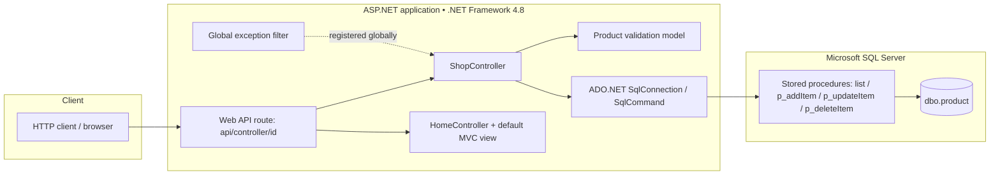
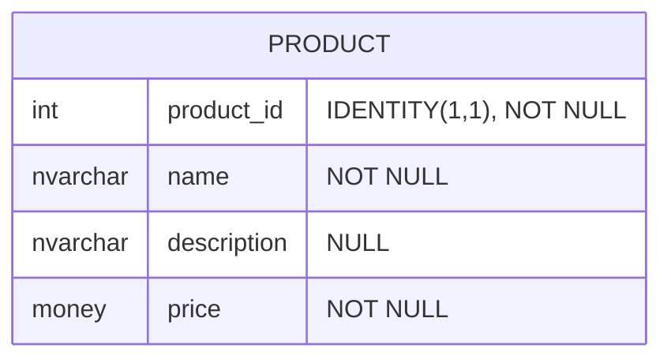
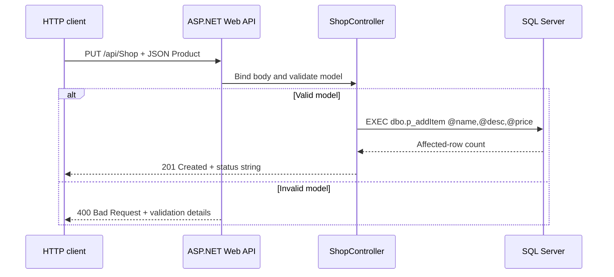
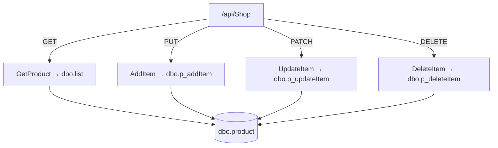

# Architecture and design

## Scope

ShopBridge is a small **product catalog CRUD API**, not a complete e-commerce storefront. It combines ASP.NET MVC (the starter web page), ASP.NET Web API 2 (product endpoints), ADO.NET, and a SQL Server database. The repository also contains scaffolding for Web API Help Page and an MSTest project.

## Component map

The global exception filter is registered but its `OnException` implementation is empty; the dashed relationship does **not** imply useful error handling.

## Product record / schema map

The included database script creates the following single table. The legacy SQL script does not declare a primary-key constraint; this diagram describes the columns, not an enforced key.

| API model | SQL column | Notes |
| --- | --- | --- |
| `Product_ID` (`decimal`) | `product_id` (`int IDENTITY`) | Different CLR and database types; used for update/delete |
| `ProductName` (`string`) | `name` (`nvarchar(max)`) | Required; model length range 3–100 |
| `ProductDescription` (`string`) | `description` (`nvarchar(max)`) | Optional |
| `ProductPrice` (`decimal`) | `price` (`money`) | Required; **no positive-only check** in current model |

There is no ORM, repository layer, authentication middleware, or front-end product catalog implemented in the checked-in source.

## Write-request sequence

Other write operations use `PATCH` → `p_updateItem` and `DELETE` → `p_deleteItem`. Retrieval uses `GET` → `dbo.list` via `SqlDataAdapter`/`DataTable`.

## Request and stored-procedure map

**Important route detail:** `ShopController` uses `[HttpGet]`, `[HttpPut]`, `[HttpPatch]` and `[HttpDelete]`, while the configured route is `api/{controller}/{id}`. The action method names are not extra URL segments. For example, the create endpoint is `PUT /api/Shop`, **not** `/api/Shop/AddItem`.

## Repository directory map

| Path | Purpose |
| --- | --- |
| `ShopBridge/Controllers/ShopController.cs` | Product API + direct SQL calls |
| `ShopBridge/Models/Product.cs` | Request model and validation attributes |
| `ShopBridge/App_Start/WebApiConfig.cs` | API routes and exception-filter registration |
| `ShopBridge/Filters/CustomExceptionFilter.cs` | Empty custom exception-filter implementation |
| `ShopBridge/Views/Home/Index.cshtml` | Default ASP.NET MVC starter page |
| `ShopBridge/Areas/HelpPage/` | Generated/help-page infrastructure |
| `ShopBridge.Tests/` | MSTest tests for starter controllers |
| `DB Scripts/script.sql` | Original destructive database script |
| `DB Scripts/setup-safe.sql` | Proposed non-destructive local bootstrap |
| `examples/ShopBridge.http` | HTTP smoke-test requests |

## Design constraints

- All database access is synchronous even though controller methods return `Task<HttpResponseMessage>` wrappers.
- Stored procedures are parameterized, reducing SQL injection risk for the operations shown.
- `SqlCommand.CommandTimeout = 0` removes the command timeout for write requests and listing.
- Read returns all products; no pagination, sorting, filtering or authentication is implemented.
- See [security and limitations](security-and-limitations.md) before any network-exposed deployment.
