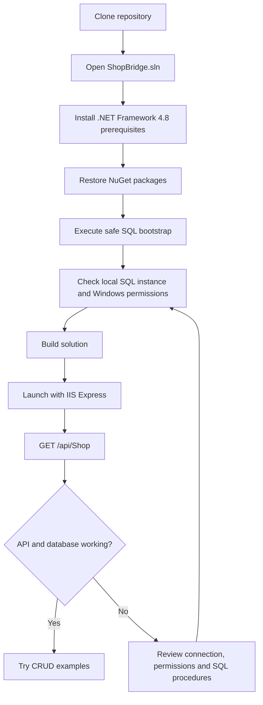

# Local installation and setup

This guide documents the **existing ASP.NET Framework application**, not an ASP.NET Core application. The manual Visual Studio/IIS Express setup steps are inferred from source. The GitHub Actions workflow independently builds the solution and tests the SQL bootstrap with disposable SQL Server LocalDB; check the PR's latest CI run for results. IIS Express + HTTP endpoint testing remains manual.

## 1. Prerequisites

| Component | Requirement | Evidence |
| --- | --- | --- |
| Operating system | Windows development environment | Classic ASP.NET/.NET Framework and IIS Express hosting |
| IDE | Visual Studio with **ASP.NET and web development** workload | `ShopBridge.sln`, web-application project |
| Runtime | **.NET Framework 4.8** targeting/developer pack | `ShopBridge/ShopBridge.csproj`, `Web.config` |
| Database | Microsoft SQL Server (SQL Server 2019+ is a practical local choice) | ADO.NET `System.Data.SqlClient`, T-SQL stored procedures |
| SQL administration | SQL Server Management Studio (SSMS) or `sqlcmd` | SQL scripts use `GO` batches |
| Dependencies | NuGet package restore from `packages.config` | Both project package manifests |
| Browser/API client | Browser plus an HTTP client (Postman, curl, or Visual Studio) | API uses HTTP requests |

## 2. Clone and open

```powershell
git clone https://github.com/krishnabhunia/ShopBridge.git
cd ShopBridge
```

Open `ShopBridge.sln` in Visual Studio, allow NuGet packages to restore (or right-click the solution and choose **Restore NuGet Packages**), then build the solution. Select the `ShopBridge` web project as the startup project.

> The application targets .NET Framework 4.8. A modern `dotnet run` workflow for ASP.NET Core does **not** apply.

## 3. Prepare the SQL Server database

**Recommended for a fresh local environment:** open `DB Scripts/setup-safe.sql` in SSMS connected to a SQL Server instance and execute it. That script creates the database/table only if missing and creates or updates the four stored procedures without dropping user data. Read the script before executing it, especially on a shared instance.

**Do not casually run `DB Scripts/script.sql`.** The original legacy script contains `DROP DATABASE IF EXISTS [db_ShopBridge]` and hard-coded SQL Server data-file paths. Running it on an instance with a pre-existing database can destroy its data, and the hard-coded file paths may not match your installation.

The application expects:
- Database: `db_ShopBridge`
- Table: `dbo.product`
- Procedures: `dbo.list`, `dbo.p_addItem`, `dbo.p_updateItem`, `dbo.p_deleteItem`

Verify in SSMS:

```sql
USE [db_ShopBridge];
SELECT TOP (10) product_id, name, description, price
FROM dbo.product;
```

## 4. Configure the database connection

The actual connection is **currently defined in source code**, in `ShopBridge/Controllers/ShopController.cs`. It uses:
- Server/instance: `.` (local **default** SQL Server instance)
- Database: `db_ShopBridge`
- Authentication: `Integrated Security=true` (Windows authentication)

If you installed a **named instance** (for example SQL Server Express), adjust the server/instance in that controller to match your machine before compiling. The IIS Express/Visual Studio process identity must have permission to connect to the database and execute the stored procedures. Prefer a dedicated least-privilege account and configuration outside source code in a future hardening PR.

**Security note:** the controller also contains unused hard-coded SQL-login constants. Do not copy or activate those credentials; see [security and limitations](security-and-limitations.md). This documentation PR does not change the runtime configuration.

## 5. Build and launch

1. Build `ShopBridge.sln` in Visual Studio (restore packages if prompted).
2. Run the `ShopBridge` startup project with **IIS Express**.
3. Confirm the home page loads. It is the stock ASP.NET starter page, **not** a product-list UI.
4. Check the actual URL shown by Visual Studio. The project file contains a historical IIS URL of `http://localhost:26536/`, but your local port may differ.

## 6. Smoke-test the API

Using your actual local port:

```powershell
curl.exe -i -H "Accept: application/json" "http://localhost:26536/api/Shop"
```

When the database is empty, the response should be an empty collection or equivalent serialized `DataTable` representation, depending on negotiated media type. CRUD requests are documented in [API reference](api.md) and `examples/ShopBridge.http`.

## Setup workflow



## Troubleshooting

| Symptom | Likely cause | What to check |
| --- | --- | --- |
| Visual Studio cannot load project | Missing web workload or .NET Framework targeting pack | Install required Visual Studio components |
| Missing assembly / package references | NuGet packages not restored | Restore packages from the solution |
| SQL connection error | Wrong SQL instance, SQL Server not running, Windows identity cannot connect | `ShopController.cs` connection, SQL service, Windows access |
| `Could not find stored procedure` | Bootstrap not run on the expected database | Run `setup-safe.sql`, verify instance/database |
| `Invalid object name 'product'` | Wrong database/schema or missing table | Verify `dbo.product` exists |
| HTTP 404 | Wrong port or endpoint path | Use `/api/Shop`; project route is `api/{controller}/{id}` |
| HTTP 400 for writes | Model validation | `ProductName` 3–100 chars and `ProductPrice` required |

Do not assume that startup or integration tests pass until they have been run on a supported Windows development machine.
